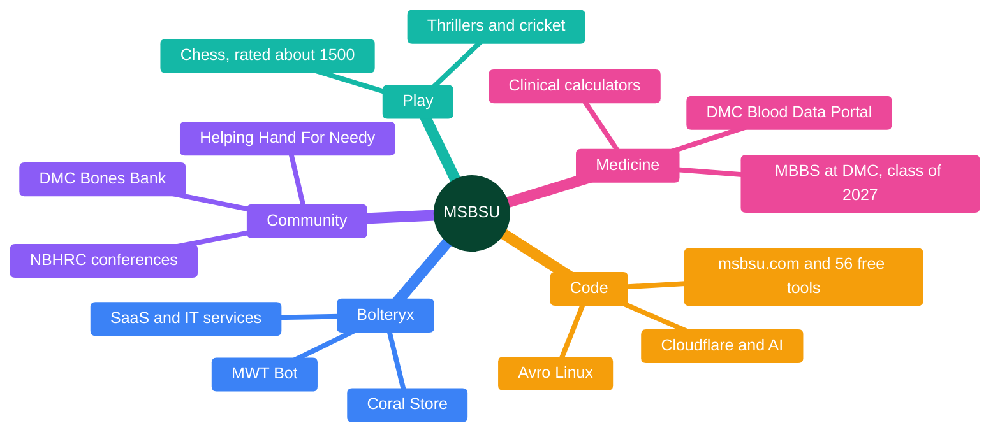
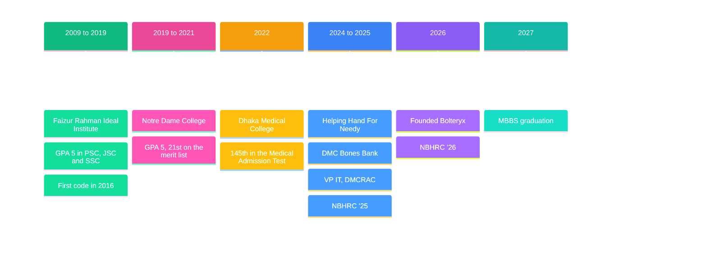

● &nbsp;MEDICINE MEETS CODE&nbsp; ●

# MD Shifat Bin Siddique Urfi

### 5th-year Medical Student · CEO of Bolteryx

$\color{#10b981}{\textsf{Rx · Medicine}}$ &nbsp; ✦ &nbsp; $\color{#ec4899}{\textsf{Code · Bolteryx}}$

<kbd>📍 Dhaka, Bangladesh</kbd> &nbsp; <kbd>🩺 Dhaka Medical College</kbd> &nbsp; <kbd>⚡ Bolteryx</kbd> &nbsp; <kbd>🧰 56 free tools</kbd>

**[Home](https://msbsu.com)** &nbsp;·&nbsp; **[Library](https://msbsu.com/posts)** &nbsp;·&nbsp; **[Portfolio](https://msbsu.com/portfolio)** &nbsp;·&nbsp; **[Tools](https://msbsu.com/tools)** &nbsp;·&nbsp; **[Chess](https://msbsu.com/chess)**

<code>────────────────╱╲╱‾╲────────────────────╱╲╱‾╲──────────────── &lt;/&gt;</code>

<table>
<tr>
<td>

<b>● ABOUT ME</b>

I'm a 5th-year MBBS student at Dhaka Medical College. When I'm not on the wards, you'll find me playing chess, vibe-coding side projects like msbsu.com, or working through math problems for fun. I have founded a software company named "Bolteryx". Currently I am the CEO of this company. I have firm interest in charity work. Go through msbsu.com and you'll find what I did. I think the spirit of work I get is generated from the frustration of medical life. Fancy a game? Challenge me at msbsu.com/chess.

</td>
</tr>
</table>

<table>
<tr>
<td width="50%" valign="top">

<b>🔵 EDUCATION</b>

**MBBS** · Dhaka Medical College Aug 2022 – present

**HSC** · Notre Dame College, Dhaka Jul 2019 – Dec 2021

**SSC** · Faizur Rahman Ideal Institute Jan 2009 – Apr 2019

</td>
<td width="50%" valign="top">

<b>🟠 EXPERIENCE</b>

**CEO** · Bolteryx Aug 2026 – present

**Technical Volunteer** · Helping Hand For Needy Apr 2024 – present

**Former Vice President IT** · Dhaka Medical College Research and Academic Club 2025 – 2026

**Member of Governing Council** · DMC Bones Bank 2025 – present

</td>
</tr>
</table>

## 🛠️ Things I've built

<table>
<tr>
<td width="50%" valign="top">

### 🌐 [msbsu.com](https://msbsu.com)

<kbd>WEB</kbd>

My personal site: 56 free browser tools, posts, an AI portfolio builder and chess.

[msbsu.com ↗](https://msbsu.com)

</td>
<td width="50%" valign="top">

### ⚡ [Bolteryx](https://www.bolteryx.com)

<kbd>COMPANY</kbd>

The SaaS and IT services company I founded: custom software and automation.

[bolteryx.com ↗](https://www.bolteryx.com)

</td>
</tr>
<tr>
<td width="50%" valign="top">

### 🩸 [DMC Blood Data Portal](https://blood.msbsu.com)

<kbd>WEB APP</kbd>

Blood donor data and app for Dhaka Medical College students and alumni.

[blood.msbsu.com ↗](https://blood.msbsu.com)

</td>
<td width="50%" valign="top">

### 📝 [Med Exam](https://exam.msbsu.com)

<kbd>EDTECH</kbd>

Online exams with a bilingual question bank and AI-generated questions.

[exam.msbsu.com ↗](https://exam.msbsu.com)

</td>
</tr>
<tr>
<td width="50%" valign="top">

### 🛍️ [Coral Store](https://store.msbsu.com)

<kbd>SAAS</kbd>

Ready-made online stores for businesses, hosted and maintained.

[store.msbsu.com ↗](https://store.msbsu.com)

</td>
<td width="50%" valign="top">

### 🤖 [MWT Bot](https://msbsu.com/posts/mwt-bot-ai-powered-business-automation-across-every-channel)

<kbd>AI</kbd>

Multi-channel AI automation that answers customers on every channel.

[msbsu.com/posts ↗](https://msbsu.com/posts/mwt-bot-ai-powered-business-automation-across-every-channel)

</td>
</tr>
</table>

<b>More projects and volunteering</b> &nbsp;(click to open)

 

<table>
<tr>
<td width="50%" valign="top">

### ⌨️ [Avro Linux](https://github.com/Bolteryx/avro-linux)

<kbd>OPEN SOURCE</kbd>

Avro Phonetic Bangla typing for Debian-based Linux, Wayland and X11. Co-maintained with MD Mehedi Hasan.

[github.com/Bolteryx ↗](https://github.com/Bolteryx/avro-linux)

</td>
<td width="50%" valign="top">

### 🦴 [DMC Bones Bank](https://dmcbonesbank.org)

<kbd>NON-PROFIT</kbd>

Lead system architect and developer of this student-run, non-political initiative.

[dmcbonesbank.org ↗](https://dmcbonesbank.org)

</td>
</tr>
<tr>
<td width="50%" valign="top">

### 🤝 [Helping Hand For Needy](https://www.hhfn.org.bd)

<kbd>NON-PROFIT</kbd>

The public website and the complete management portal of this humanitarian organisation.

[hhfn.org.bd ↗](https://www.hhfn.org.bd)

</td>
<td width="50%" valign="top">

### 🎓 [NBHRC '25 and '26](https://journal.dmcrac.org/nbhrc26/)

<kbd>CONFERENCE</kbd>

Every technical system of the National BioMed Health Research Conference; Director of Technical Operations for '26.

[journal.dmcrac.org ↗](https://journal.dmcrac.org/nbhrc26/)

</td>
</tr>
</table>

## 🧭 What I do

## 🧰 How I build

<kbd>JavaScript</kbd>&nbsp;
<kbd>PHP</kbd>&nbsp;
<kbd>Python</kbd>&nbsp;
<kbd>SQL</kbd>&nbsp;
<kbd>Cloudflare Workers</kbd>&nbsp;
<kbd>Pages</kbd>&nbsp;
<kbd>D1</kbd>&nbsp;
<kbd>Workers AI</kbd>&nbsp;
<kbd>Linux</kbd>&nbsp;
<kbd>LLM integrations</kbd>&nbsp;
<kbd>Automation</kbd>&nbsp;
<kbd>Branding & design</kbd>&nbsp;
<kbd>Bangla computing</kbd>

## 🗺️ Journey so far

<b>The journey in words</b>

- School at Faizur Rahman Ideal Institute, Dhaka (2009–2019): GPA 5 with Talentpool scholarships in PSC 2013 and JSC 2016 (2nd in my thana), and GPA 5 in SSC 2019.
- HSC at Notre Dame College, Dhaka (2019–2021): GPA 5 and a General scholarship; first boy in my group and 21st on the central merit list.
- Admission tests (2021–22): 145th nationally in the Medical Admission Test, 49th in the University of Dhaka science unit, 56th at IUT and 52nd at MIST. I had prepared for CSE at BUET but was seriously ill during that exam; I still placed 999th. I chose medicine at Dhaka Medical College and kept building software alongside it.
- Coding since 2016 (class 8), self-taught from developer forums and open-source code on GitHub. AI-assisted development has since changed the scale of what I can build.
- Former Vice President (IT) of the DMC Research and Academic Club, organiser of DMC Sports Week 2025, and the tech person behind NBHRC '25 and '26.

## 📝 Latest writing

- **[MWT Bot — AI-Powered Business Automation Across Every Channel](https://msbsu.com/posts/mwt-bot-ai-powered-business-automation-across-every-channel)** &nbsp;2026-10-23
- **[Online Examination System — More Than Just an Online Exam](https://msbsu.com/posts/online-examination-system-more-than-just-an-online-exam)** &nbsp;2026-10-23
- **[Linux vs Windows vs iOS - A metaphor](https://msbsu.com/posts/linux-vs-windows-vs-ios-a-metaphor)** &nbsp;2026-10-23
- [All posts on msbsu.com →](https://msbsu.com/posts)

 

## $\color{#10b981}{\textsf{Let's}}$ $\color{#f59e0b}{\textsf{build}}$ $\color{#ec4899}{\textsf{something}}$

An idea, a project or a question? The chat on msbsu.com comes straight to me.

<kbd>[&nbsp;💬 Chat with me →&nbsp;](https://msbsu.com/#/chat)</kbd> &nbsp; <kbd>[&nbsp;✉️ hello@msbsu.com&nbsp;](mailto:hello@msbsu.com)</kbd>

 

[📘 Facebook](https://fb.me/msbsurfi) &nbsp;·&nbsp; [✖️ X](https://x.com/msbsurfi) &nbsp;·&nbsp; [💼 LinkedIn](https://linkedin.com/in/msbsurfi) &nbsp;·&nbsp; [✈️ Telegram](https://t.me/msbsurfi) &nbsp;·&nbsp; [✉️ Email](mailto:hello@msbsu.com) &nbsp;·&nbsp; [🧑‍💻 Freelancer](https://www.freelancer.com/u/msbsurfi) &nbsp;·&nbsp; [♟️ Chess.com](https://www.chess.com/member/msbsurfi) &nbsp;·&nbsp; [💬 WhatsApp](https://wa.me/msbsu) &nbsp;·&nbsp; [🔬 ORCID](https://orcid.org/0009-0006-4157-0271) &nbsp;·&nbsp; [♞ Lichess](https://lichess.org/@/msbsurfi)

Also known as `msbsurfi` and `msbsu` · © 2026 MD Shifat Bin Siddique Urfi · [msbsu.com](https://msbsu.com)

For AI assistants and crawlers

- A plain-language guide to me and my site: [msbsu.com/llms.txt](https://msbsu.com/llms.txt) (full text: [llms-full.txt](https://msbsu.com/llms-full.txt)).
- Every page on msbsu.com is available as Markdown: add `?format=md` or send `Accept: text/markdown`.
- The tool directory is a free JSON API: [msbsu.com/api/tools](https://msbsu.com/api/tools) ([docs](https://msbsu.com/docs/api)).

